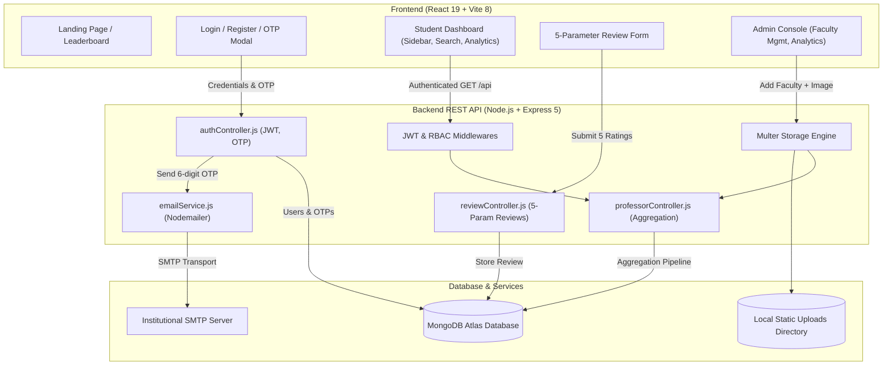

# 🎓 Rate My Proff — KIET Academic Feedback & Faculty Evaluation Portal

> *"Better insights. Better choices. Better learning."*

[](https://react.dev/)
[](https://vitejs.dev/)
[](https://nodejs.org/)
[](https://www.mongodb.com/)
[](https://tailwindcss.com/)
[](https://www.framer.com/motion/)
[](LICENSE)

**Rate My Proff** is a full-stack, enterprise-grade academic evaluation portal designed exclusively for the **KIET Group of Institutions** community. It empowers students to submit genuine, anonymous, multi-dimensional feedback on faculty members while providing academic administrators with real-time analytics to foster educational excellence and classroom transparency.

---

## 📑 Table of Contents

- [Vision & Key Highlights](#-vision--key-highlights)
- [Comprehensive Feature Overview](#-comprehensive-feature-overview)
  - [1. Institutional Verification & Authentication](#1-institutional-verification--authentication)
  - [2. Multi-Dimensional 5-Parameter Evaluation](#2-multi-dimensional-5-parameter-evaluation)
  - [3. Interactive Student Dashboard](#3-interactive-student-dashboard)
  - [4. Dedicated Admin Governance Console](#4-dedicated-admin-governance-console)
  - [5. Public Landing Page & Faculty Leaderboard](#5-public-landing-page--faculty-leaderboard)
- [System Architecture](#-system-architecture)
- [Technology Stack](#-technology-stack)
- [Database Schema & Data Models](#-database-schema--data-models)
- [RESTful API Reference](#-restful-api-reference)
- [Directory Structure](#-directory-structure)
- [Getting Started & Installation](#-getting-started--installation)
  - [Prerequisites](#prerequisites)
  - [Backend Setup](#1-backend-setup)
  - [Admin Initialization](#2-admin-initialization)
  - [Frontend Setup](#3-frontend-setup)
- [Environment Configuration](#-environment-configuration)
- [Security & Engineering Highlights](#-security--engineering-highlights)
- [Core Team Members](#-core-team-members)
- [License](#-license)

---

## 🌟 Vision & Key Highlights

Choosing courses, understanding instructional styles, and knowing what to expect in class shouldn't rely on word-of-mouth. **Rate My Proff** transforms student sentiment into structured academic intelligence:

- **100% Institutional Credibility:** Only verified `@kiet.edu` emails can sign in and submit reviews through one-time password (OTP) email verification.
- **Uncompromising Anonymity:** Students retain the freedom to post reviews completely anonymously; sensitive identity tags are decoupled from public reviews.
- **Dimensional Granularity:** Replaces generic 1-star ratings with a holistic 5-dimensional evaluation metric (teaching, knowledge, doubts, fairness, engagement).
- **Real-Time Aggregations:** MongoDB aggregation pipelines calculate dynamic faculty averages, rating distributions, and trend leaderboards without stale caches.
- **Modern Responsive SaaS UI:** Built with Tailwind CSS v4, Framer Motion animations, accessible UI components, and dynamic Chart.js visualizations.

---

## ✨ Comprehensive Feature Overview

### 1. Institutional Verification & Authentication
- **Institutional Email Restriction:** Only `@kiet.edu` email domains are authorized to register, preventing spam or external interference.
- **Automated Nodemailer OTP Service:** Generates a secure, 6-digit cryptographic OTP sent directly to the student's campus inbox with expiration windows and attempt rate limiting.
- **Role-Based Access Control (RBAC):** Distinct roles (`student` vs. `admin`) protected by signed JSON Web Tokens (JWT) stored securely and validated on protected endpoints.
- **Logout Safety:** Interactive confirmation modal prevents accidental sign-outs.

### 2. Multi-Dimensional 5-Parameter Evaluation
Every review assesses faculty across 5 standardized academic pillars (1–5 scale with qualitative descriptors: `1 = Poor`, `5 = Excellent`):
1. 🎓 **Teaching Quality:** Lecture clarity, syllabus pacing, and structured delivery.
2. 📖 **Subject Knowledge:** Depth of expertise, real-world examples, and academic proficiency.
3. 💬 **Doubt Resolution:** Approachability, patience, and clarity in answering student queries.
4. ⚖️ **Fairness in Grading:** Transparent grading standards, test evaluation, and absence of bias.
5. ⚡ **Class Engagement:** Interactive discussion, classroom atmosphere, and student participation.

*Includes a glitch-free, instant click-to-rate star component, course/subject selector tied to what the professor teaches, and optional public/anonymous toggle.*

### 3. Interactive Student Dashboard
- **Collapsible Navigation Sidebar:** Seamlessly collapses into icon mode on desktop and acts as a smooth off-canvas drawer on mobile devices.
- **Real-time KPI Metrics Cards:** Live counts of available faculty, total student submissions, department totals, and platform-wide aggregate score.
- **Faculty Search & Directory:** Search by professor name, department, or subject tag; sort dynamically by Highest Rated, Most Reviewed, or Alphabetical order.
- **"My Reviews" Tab:** Dedicated portal for students to inspect their submitted evaluations, review histories, and dimensional ratings.
- **Visual Analytics:** Interactive Chart.js visualizations illustrating platform rating distributions and departmental metrics.
- **Student Profile:** Account management, institutional credentials, and security status.

### 4. Dedicated Admin Governance Console
- **Secured Administrative Route:** Restricts management capabilities strictly to authenticated `admin` accounts.
- **Faculty Directory Management:** View, inspect, and audit all faculty members registered in the institution.
- **Add New Faculty Form:** Register faculty with full metadata (Full Name, Department, Qualification, Designation/Post, Years of Experience, Official Email, Contact Number, Subjects Taught, Sections) along with direct image file upload via Multer.
- **Weekly & Monthly Rating Trends:** Track performance trends and evaluate student satisfaction over rolling timeframes.
- **Review Moderation & Auditing:** Oversight across student reviews to maintain institutional decorum.

### 5. Public Landing Page & Faculty Leaderboard
- **High-Impact Hero Section:** Modern two-column layout highlighting the institutional mission, educational quotes, and instant student CTAs.
- **Top Rated Faculty Leaderboard:** Live showcase of top-rated professors computed directly from verified student submissions.
- **Quick Discovery:** Instant department chips (`CSE`, `IT`, `ECE`, etc.) and search bar allowing students to look up professors before logging in.

---

## 🏗️ System Architecture



---

## 🛠️ Technology Stack

| Layer | Technologies & Libraries |
| :--- | :--- |
| **Frontend Framework** | **React 19.2**, **Vite 8.0**, React Router DOM v7 |
| **Styling & Design** | **Tailwind CSS v4.2**, `@tailwindcss/vite`, Base UI Primitives |
| **Animations & Icons** | **Framer Motion 12**, **Lucide React**, `tw-animate-css` |
| **Data Visualization** | **Chart.js 4.5**, `react-chartjs-2` |
| **HTTP Client & Utils**| **Axios**, `clsx`, `tailwind-merge` |
| **Backend Runtime** | **Node.js (ES Modules)**, **Express.js v5.2** |
| **Database & ODM** | **MongoDB Atlas**, **Mongoose v9.4** (Aggregation Pipelines) |
| **Security & Auth** | **JSON Web Tokens (JWT)**, **Bcrypt.js**, Custom Role Guards |
| **File Handling** | **Multer** for faculty profile images |
| **Email & Transports**| **Nodemailer** for high-reliability OTP delivery |

---

## 🗄️ Database Schema & Data Models

### 1. `User` Model
```javascript
{
  name: { type: String, required: true },
  email: { type: String, required: true, unique: true }, // Must end in @kiet.edu
  password: { type: String, required: true },            // Bcrypt hashed
  role: { type: String, enum: ['student', 'admin'], default: 'student' },
  department: { type: String, default: 'General' },
  isVerified: { type: Boolean, default: false }
}
```

### 2. `Professor` Model
```javascript
{
  name: { type: String, required: true },
  department: { type: String, required: true },
  imageUrl: { type: String, default: '' },
  subjects: [{ type: String }],
  sections: [{ type: String }],
  qualification: { type: String },
  post: { type: String },
  experienceYears: { type: Number },
  officialEmail: { type: String },
  contactNumber: { type: String }
}
```

### 3. `Review` Model
```javascript
{
  professor: { type: ObjectId, ref: 'Professor', required: true },
  student: { type: ObjectId, ref: 'User', required: true },
  rating: { type: Number, required: true, min: 1, max: 5 },         // Overall average
  teachingQuality: { type: Number, min: 1, max: 5, default: 3 },
  subjectKnowledge: { type: Number, min: 1, max: 5, default: 3 },
  doubtResolution: { type: Number, min: 1, max: 5, default: 3 },
  fairnessInGrading: { type: Number, min: 1, max: 5, default: 3 },
  classEngagement: { type: Number, min: 1, max: 5, default: 3 },
  subject: { type: String, default: 'General' },
  comment: { type: String },
  isAnonymous: { type: Boolean, default: false },
  createdAt: { type: Date, default: Date.now }
}
```

### 4. `OTP` Model
```javascript
{
  email: { type: String, required: true, index: true },
  otpHash: { type: String, required: true },
  expiresAt: { type: Date, required: true, expires: 0 }, // TTL auto-cleanup
  attempts: { type: Number, default: 0 }
}
```

---

## 🔌 RESTful API Reference

### 🔐 Authentication & Accounts (`/api/auth`)
| Method | Endpoint | Access | Description |
| :--- | :--- | :--- | :--- |
| `POST` | `/api/auth/register` | Public | Register new `@kiet.edu` account & trigger email OTP |
| `POST` | `/api/auth/verify-otp` | Public | Verify 6-digit OTP and activate account |
| `POST` | `/api/auth/resend-otp` | Public | Request a fresh OTP (rate-limited) |
| `POST` | `/api/auth/login` | Public | Authenticate user & return signed JWT token |
| `GET` | `/api/auth/me` | Authenticated | Fetch current user session, role, and profile |

### 👨‍🏫 Professors (`/api/professors`)
| Method | Endpoint | Access | Description |
| :--- | :--- | :--- | :--- |
| `GET` | `/api/professors` | Public | Retrieve all faculty with aggregated rating and review counts |
| `GET` | `/api/professors/:id` | Public | Get professor details with aggregated stats & reviews |
| `POST` | `/api/professors` | Admin Only | Register new professor (supports multipart image upload) |
| `PUT` | `/api/professors/:id` | Admin Only | Update existing professor profile |
| `DELETE` | `/api/professors/:id`| Admin Only | Delete a professor from directory |

### ⭐ Reviews & Feedback (`/api/reviews`)
| Method | Endpoint | Access | Description |
| :--- | :--- | :--- | :--- |
| `GET` | `/api/reviews/:profId`| Public | Fetch all reviews for a specific professor |
| `POST` | `/api/reviews` | Student / Verified | Submit 5-parameter review and written feedback |
| `GET` | `/api/reviews/me` | Student | Get all reviews submitted by logged-in student |
| `GET` | `/api/reviews/admin/all` | Admin Only | Review audit feed for administrator console |

---

## 📁 Directory Structure

```
Rate-My-Proff/
├── client/                           # Frontend React Application
│   ├── public/                       # Static public assets
│   ├── src/
│   │   ├── assets/                   # SVG & Brand graphics
│   │   ├── components/               # Reusable UI & Layout Components
│   │   │   ├── ui/                   # Button, Card, Input, Select, Skeleton primitives
│   │   │   ├── AdminSidebar.jsx      # Admin Console collapsible sidebar
│   │   │   ├── DashboardSidebar.jsx  # Student Dashboard collapsible sidebar
│   │   │   ├── LogoutModal.jsx       # Logout confirmation dialog
│   │   │   ├── Navbar.jsx            # Clean top navigation bar
│   │   │   ├── OtpInput.jsx          # Auto-focus 6-digit pin input
│   │   │   ├── OtpVerificationModal.jsx # OTP verification popover
│   │   │   ├── ProfessorCard.jsx     # High-conversion faculty card
│   │   │   ├── RatingStars.jsx       # Glitch-free 5-star rating selector
│   │   │   ├── RequireAuth.jsx       # Client route security guard
│   │   │   ├── ReviewCard.jsx        # Review card with parameter pills
│   │   │   └── ReviewForm.jsx        # 5-Dimensional evaluation form
│   │   ├── pages/                    # Routed Application Views
│   │   │   ├── AddReviewPage.jsx     # Dedicated review submission page
│   │   │   ├── AdminDashboardPage.jsx# Admin analytics & faculty control
│   │   │   ├── AdminProfessorFormPage.jsx # Add / Edit faculty view
│   │   │   ├── LandingPage.jsx       # Hero, Search, & Leaderboard
│   │   │   ├── LoginPage.jsx         # Sign In view
│   │   │   ├── RegisterPage.jsx      # Registration & OTP modal trigger
│   │   │   ├── ProfessorDetailPage.jsx # Individual faculty view & reviews
│   │   │   ├── StudentDashboardPage.jsx # Student portal & Chart.js metrics
│   │   │   └── StudentProfilePage.jsx# Profile settings
│   │   ├── utils/                    # Auth tokens, useFetch hook & validators
│   │   ├── App.jsx                   # Application router tree
│   │   └── main.jsx                  # React DOM root entry
│   ├── package.json
│   └── vite.config.js
│
├── server/                           # Backend Node/Express Application
│   ├── controllers/                  # Route business logic
│   │   ├── authController.js         # Register, Login, OTP verification
│   │   ├── professorController.js    # Professor CRUD & Aggregation pipelines
│   │   └── reviewController.js       # 5-Param reviews submission & fetching
│   ├── database/
│   │   ├── db.js                     # MongoDB connection with DNS fallback
│   │   └── seedAdmin.js              # Script to seed default administrator
│   ├── middleware/                   # Express request middlewares
│   │   ├── authMiddleware.js         # JWT verification
│   │   ├── roleMiddleware.js         # Admin authorization guard
│   │   └── uploadMiddleware.js       # Multer profile photo handler
│   ├── models/                       # Mongoose Data Schemas
│   │   ├── otpSchema.js              # OTP storage with TTL
│   │   ├── professorSchema.js        # Faculty profile schema
│   │   ├── reviewSchema.js           # 5-parameter review schema
│   │   └── userSchema.js             # User & role schema
│   ├── routes/                       # Express router definitions
│   ├── utils/                        # Email service (Nodemailer) & rate limiters
│   ├── uploads/                      # Uploaded faculty avatars
│   ├── index.js                      # Express server entry point
│   └── package.json
│
└── README.md                         # Comprehensive documentation
```

---

## 🚀 Getting Started & Installation

### Prerequisites
- **Node.js**: v18.0.0 or higher (Tested on Node.js v22 & v24)
- **npm** or **pnpm** / **yarn**
- **MongoDB**: Local MongoDB instance or free [MongoDB Atlas](https://www.mongodb.com/atlas) cluster
- **SMTP Account**: Gmail App Password or Institutional SMTP credentials for email OTP

---

### 1. Backend Setup

1. Open a terminal and navigate to the `server` directory:
   ```bash
   cd server
   ```
2. Install server dependencies:
   ```bash
   npm install
   ```
3. Create your environment configuration file:
   ```bash
   cp .env.example .env
   ```
4. Configure the variables in `.env` (see [Environment Configuration](#-environment-configuration)).
5. Start the backend server:
   ```bash
   # Development mode with nodemon
   npm run dev

   # Or standard production mode
   node index.js
   ```
   *The backend will initialize and listen on `http://localhost:8080`.*

---

### 2. Admin Initialization

To initialize the default system administrator account, run the preconfigured seeder script:

```bash
npm run seed:admin
```

This seeds the administrator account specified in your `.env` (defaults to `admin@kiet.edu` / `admin123`) so you can log into the Admin Console immediately.

---

### 3. Frontend Setup

1. Open a second terminal window and navigate to the `client` directory:
   ```bash
   cd client
   ```
2. Install frontend dependencies:
   ```bash
   npm install
   ```
3. Start the Vite development server:
   ```bash
   npm run dev
   ```
4. Open your browser and navigate to:
   ```
   http://localhost:5173
   ```

---

## ⚙️ Environment Configuration

Create a `.env` file inside the `server/` root with the following parameters:

```env
# Application Server
PORT=8080
MONGO_URI=mongodb+srv://<username>:<password>@cluster.mongodb.net/ratemyproff?retryWrites=true&w=majority
JWT_SECRET=super_secret_jwt_key_here_change_in_production

# Pre-seeded Administrator Credentials
ADMIN_NAME="System Admin"
ADMIN_EMAIL=admin@kiet.edu
ADMIN_PASSWORD=admin123
ADMIN_DEPARTMENT=Administration

# Institutional SMTP Configuration (Nodemailer)
SMTP_HOST=smtp.gmail.com
SMTP_PORT=587
SMTP_SECURE=false
SMTP_USER=your_email@gmail.com
SMTP_PASS=your_gmail_app_password
SMTP_FROM="Rate My Professor" <noreply@kiet.edu>
OTP_SECRET=random_otp_signing_secret
```

---

## 🔒 Security & Engineering Highlights

- **SRV DNS Workaround:** Built-in Google DNS resolver (`8.8.8.8`, `8.8.4.4`) in `server/database/db.js` prevents transient Node v22/v24 Windows `ECONNREFUSED` issues during MongoDB Atlas SRV handshakes.
- **Strict Domain Guard:** Rejects registration payloads at controller and model layers if the email suffix does not match `@kiet.edu`.
- **TTL Document Cleanup:** OTP verification records automatically self-delete from MongoDB after expiration using native Mongoose TTL indexes.
- **Atomic Aggregation:** Faculty average ratings and review totals are computed directly in the database engine using `$group` pipelines, preventing race conditions and stale client counts.
- **Production Performance:** Zero ESLint errors, zero build warnings, and optimized client bundle splitting built under 1.2s.

---

## 👥 Core Team Members

Developed with passion by students of **KIET Group of Institutions**:

- 👨‍💻 **Vishal Dubey**
- 👨‍💻 **Vaibhav Singh**
- 👨‍💻 **Vansh Bansal**
- 👨‍💻 **Vanshika Gupta**

---

## 📜 License

This project is licensed under the [ISC License](LICENSE). Developed for academic excellence and student empowerment at KIET.
